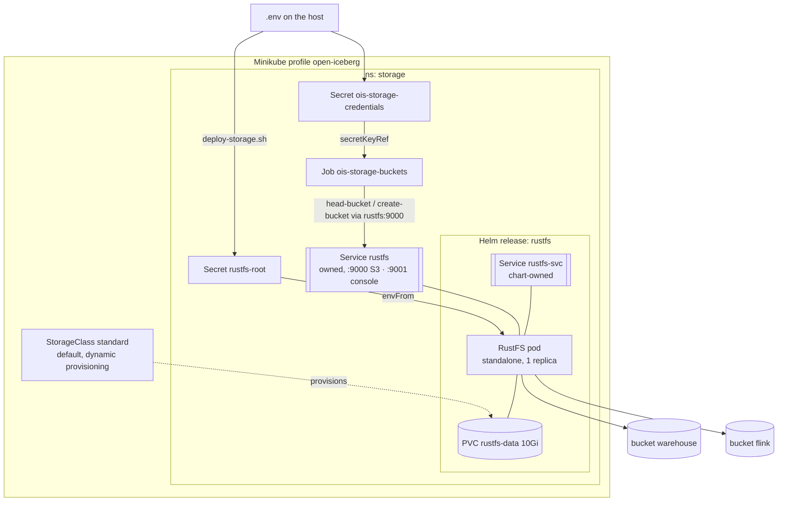
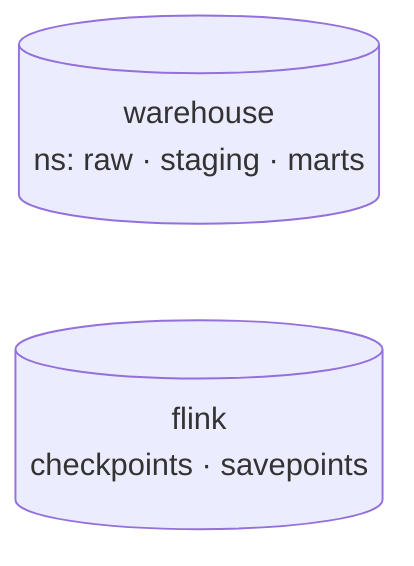

# LLD 01 — Foundation & Storage Substrate

**Layer:** Kubernetes + S3 storage

## Purpose & scope

Provision the local Kubernetes cluster and the S3-compatible object store that
every later layer builds on. **In scope:** the Minikube cluster and its default
StorageClass, per-component namespaces, RustFS with persistent storage, the
storage credentials, and the `warehouse` and `flink` buckets. **Out of scope:**
TLS, production hardening, any catalog or engine.

## Component internals

The chart creates the RustFS Deployment, its PVCs and a Service named
`rustfs-svc`. The stack adds a Service of its own named `rustfs` over the same
pod selector (`app.kubernetes.io/name: rustfs`, `app.kubernetes.io/instance: rustfs`),
so the address every consumer uses does not depend on the chart's naming.

## Configuration contract

Assets: `components/storage/values.yaml` (Helm values),
`components/storage/service.yaml` (the `rustfs` Service) and
`components/storage/buckets-job.yaml` (the buckets Job).
`scripts/deploy-storage.sh` applies them in that order.

| Concern | Setting | Notes |
| :--- | :--- | :--- |
| Cluster | Minikube profile `open-iceberg`, docker driver, `components/cluster/cluster.env` | addons `default-storageclass` + `storage-provisioner` give the default `standard` StorageClass |
| Chart | `rustfs` from `RUSTFS_CHART_REPO`, version `RUSTFS_CHART_VERSION`, app `RUSTFS_APP_VERSION` | all pinned in `components/versions.env`; installed with `helm upgrade --install --repo … --version …`, no `helm repo add` |
| Deploy mode | `mode.standalone.enabled: true`, `mode.distributed.enabled: false`, `replicaCount: 1` | the chart defaults to distributed with 4 replicas; one pod and one data volume is enough for a single-node playground |
| Persistence | `storageclass.name: standard`, `dataStorageSize: 10Gi`, `logStorageSize: 256Mi` | the chart default class `local-path` does not exist on Minikube, so its PVCs would stay `Pending` |
| Resources | requests `cpu 50m / memory 128Mi`, limit `memory 256Mi` | the dev-tier budget for storage |
| Ingress | `ingress.enabled: false` | the chart enables an nginx Ingress by default; there is no ingress controller and access is via Services |
| Ports | S3 API `9000`, console `9001` | on both `rustfs` and `rustfs-svc` |
| Credentials | `secret.existingSecret: rustfs-root` | see [Credentials](#credentials); `values.yaml` holds no credential |
| Endpoint | `http://rustfs.storage.svc.cluster.local:9000` | **path-style** addressing, region `us-east-1` (dummy) |
| Buckets | `warehouse`, `flink` | see [Bucket layout](#bucket-layout) |
| Bucket creation | Job `ois-storage-buckets` running `AWSCLI_IMAGE` | per bucket: `head-bucket`, then `create-bucket` only if missing; the list lives only in its `BUCKETS` env var |

### Credentials

The host's gitignored `.env` holds `RUSTFS_ROOT_USER` and `RUSTFS_ROOT_PASSWORD`.
`deploy-storage.sh` reads only those two keys, writes them to a `chmod 600` temp
file and creates the Secrets with `kubectl create secret generic --from-env-file`
piped through `--dry-run=client -o yaml | kubectl apply -f -`, so no value ever
appears on a command line and re-runs are idempotent.

| Secret (ns `storage`) | Keys | Read by |
| :--- | :--- | :--- |
| `rustfs-root` | `RUSTFS_ACCESS_KEY`, `RUSTFS_SECRET_KEY` | the RustFS pod, via `envFrom` |
| `ois-storage-credentials` | `access-key`, `secret-key` | every S3 client: the buckets Job, Polaris, Flink, … |

There are two because `envFrom` turns every key into an environment variable
name: the chart needs the `RUSTFS_*` names, while consumers reference
`access-key` / `secret-key` with `secretKeyRef`. Both hold the same values. The
chart refuses empty credentials and the well-known `rustfsadmin` default.

### Bucket layout

| Bucket | Holds |
| :--- | :--- |
| `warehouse` | all Iceberg data and metadata; the catalog's base location |
| `flink` | Flink checkpoints under `checkpoints/<stream>` and savepoints under `savepoints/<stream>` |

The medallion tiers `raw`, `staging` and `marts` are catalog namespaces inside
`warehouse`, not buckets. Iceberg tables carry their own location, so one bucket
per tier would only add credentials and configuration, with no isolation gain on
a single node.

### Bucket creation

The Job's pod template has an `__AWSCLI_IMAGE__` placeholder; the deploy step
replaces it with `AWSCLI_IMAGE` from `components/versions.env`. Jobs are
immutable, so every deploy deletes the previous Job, applies a new one and waits
for completion. A failed Job makes the deploy print the Job logs and exit
non-zero. Existing buckets are only checked, never recreated, so their data is
untouched.

## Durability model

RustFS's object data lives on the `rustfs-data` PVC, provisioned by the
`standard` StorageClass, not in the pod. The pod is disposable: if it is deleted
or rescheduled, the same PVC re-binds to the replacement and all objects remain
intact. This is what lets every layer above treat RustFS as durable storage.
Deleting the PVC, the release or the Minikube profile deletes the data.

## Inputs consumed / outputs produced

**Consumes:** nothing — this is the foundation layer.

**Produces — the foundation contract (to all layers above):**

| What | Value |
| :--- | :--- |
| Asset layout | `components/<component>/`; pinned versions in `components/versions.env` (`KEY="value"`) |
| Namespaces | `storage`, `ingestion`, `catalog`, `processing`, `query`, `orchestration`, `bi` (`components/namespaces.yaml`) |
| Helm usage | `helm upgrade --install … --repo <url> --version <pinned>`; never `helm repo add` |
| S3 endpoint (in-cluster) | `http://rustfs.storage.svc.cluster.local:9000`, path-style, region `us-east-1` |
| S3 endpoint (host) | `kubectl --context open-iceberg -n storage port-forward svc/rustfs 9000:9000 9001:9001` |
| S3 credentials | `Secret/ois-storage-credentials` in `storage`, keys `access-key`, `secret-key` |
| Buckets | `warehouse` (Iceberg data, catalog base location), `flink` (checkpoints, savepoints) |
| Persistence | RustFS data on one 10Gi PVC from the default `standard` StorageClass |
| Cluster | Minikube profile `open-iceberg`; every `kubectl`/`helm` call passes this context explicitly |

Target folders: `components/cluster/` (cluster definition), `components/storage/`
(Helm values, `rustfs` Service, buckets Job), `scripts/` (`cluster-up.sh`,
`cluster-down.sh`, `setup-namespaces.sh`, `deploy-storage.sh`, `check-storage.sh`).
